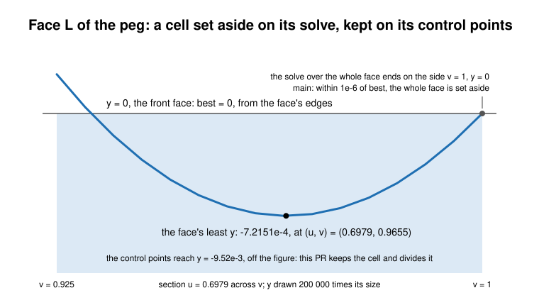

Updates: WR-588

#### WR-588 (update, 2026-11-14). A cell with control points is set aside only on them (#13753)

- **Location:** the fork's `sm_FaceDirectedMax` (`source/SMLib/src/SmFace.cpp`,
  tangency-labs/smlib@9d44c1b), not in the pinned SMLib; the port's `face_directed_max_with`
  (`crates/solidcore/src/query/face/p3.rs`).
- **What happens:** a cell's solve gives a value the surface takes, a lower bound on the
  cell's greatest, not an upper one. The search set a cell aside when that value was within
  `EFF_ZERO_SQRT` of the best so far (1.), took it as the cell's greatest when its point lay in
  the face (2.), and took the solve's least as the cell's least (3.). A higher point the solve
  missed was never looked for.
- **Trigger:** the Mixed chamfer face L of the rig case
  `fillets/report-peg-front-and-concave-chamfers-together-d2` dips to y = -7.2151e-4 beside its
  side v = 1, which lies in the front face y = 0. In -y the edges give best = 0, the solve over
  the whole face ends on that side at y = 0, and the whole face was set aside: face and body
  boxed to y min 0.

*The dip the whole-face solve misses, and the control points that keep the cell.*

- **Fix:** a cell with control points (its subpatch, `cell_patch`) is decided on them, as
  Moore–Skelboe branch and bound (Skelboe, BIT 14 (1974) 87–95) discards a box only on a bound
  of it: 1. on their greatest (the convex hull property of a B-spline with positive weights,
  Piegl and Tiller §4.4), a value at a point inside the face only raising best (2.); 3. on
  their least, less the subpatch's rounding (`sub_patch_rounding`), above best by the face's
  zone tolerance, with every solution classified outside; a cell at the limits counts with its
  own bound (`unsolved_cell_top`). The subpatch's net closes on the surface quadratically as
  the cell shrinks (Dahmen, J. Comp. Appl. Math. 16 (1986) 145–158). A way along which a
  cell's control values are level is not halved, since its halves keep its hull: a greatest
  value along a line inside a face (a cylinder's) would otherwise double its cells at every
  depth to the cell limit. The search asks for cancellation at every cell. A face without
  control points (an analytic surface, one closed in u or v) keeps the fork's rules.
  Regression tests: `a_dip_the_whole_domain_solve_misses_is_inside_the_box` (face L as a
  sheet) and `a_ridge_along_a_face_is_divided_only_across_it`
  (`crates/solidcore/tests/issue_1799_tight_box_divides_at_knots.rs`).
